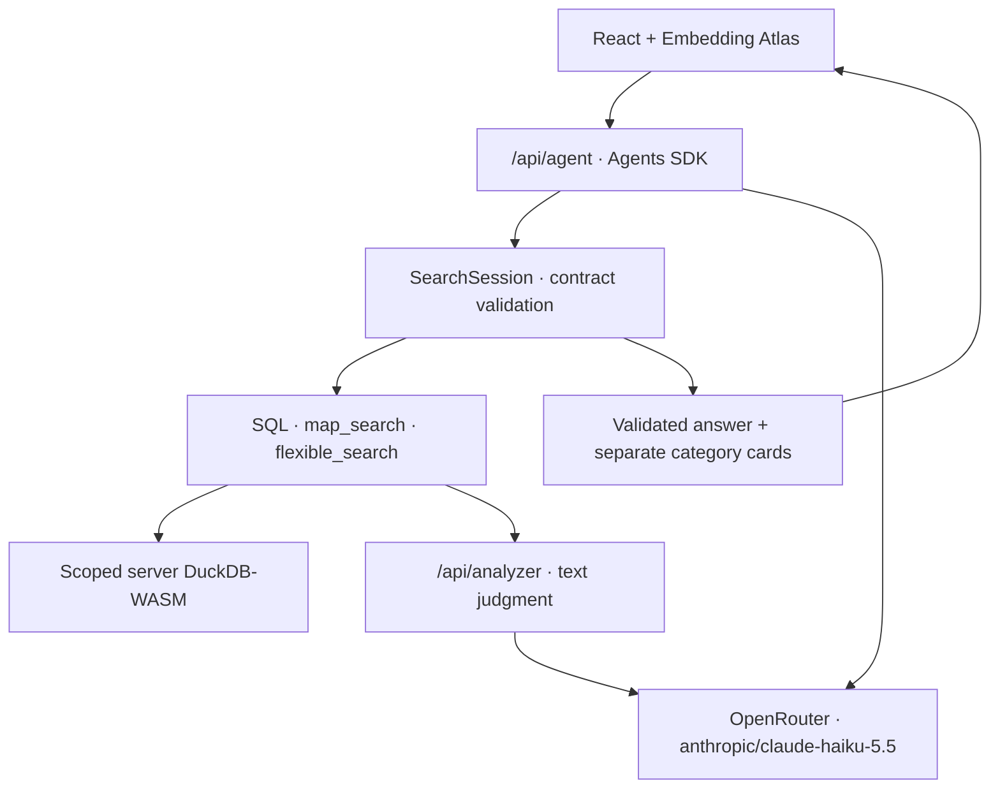

# Projection-Guided Agentic Search

An agent explores a two-dimensional embedding map by locating candidate regions, judging their review text, and answering from validated evidence. The demo uses **130k wine reviews** and Apple's Embedding Atlas.

The projection is a candidate-generation space, not semantic ground truth. Runtime search uses map coordinates, lexical retrieval and structured data; it does not call an embedding service or vector index.

## How it works

1. **Choose a workflow.** Load the relevant Topic Ring Probe playbook before searching.
2. **Locate candidate regions.** Use normalized density grids, the user's selected scope, or lexical seed islands. A ring is a bounded rectangle.
3. **Judge the evidence.** `flexible_search` runs diversified recall inside one region, then asks an Analyzer to assess intent fit and content coherence.
4. **Adapt the search.** Accept evidence, refine a mixed ring once, visit a sibling, or discard an off-intent region. SearchSession validates transitions and budgets; the model chooses the route.
5. **Answer with the right evidence.** Accepted categories become separate interactive cards. Exact SQL analytics and direct row lookups use their own evidence paths. Thin coverage yields a bounded partial answer.

See [Topic Ring Probe](web-app/docs/PROJECTION_AGENT_SEARCH.md) for schemas, scope, provenance, stopping rules and implementation adaptations.

## Architecture

The browser owns selection and presentation. Selected IDs fix an immutable server query scope. Current-turn results can scope later tools via workspace result sets. A compact ring ledger carries navigation context into the next turn; historical judgments do not become fresh evidence.

## Capabilities

- Topic and flavor exploration using region-constrained text judgments.
- Exact SQL counts and breakdowns by price, rating, variety and country.
- Explicit literal/proxy counts, clearly separated from semantic prevalence.
- Selected-subset exploration and direct review examples.
- Category cards and map highlights grounded in tool-returned direct evidence.

Example questions:

- "What are the common flavors in Tuscan wines?"
- "How many French wines score at least 90 points and cost under $20?"
- "Compare the themes in these selected reviews."
- "Find examples of wines described as earthy and tannic."

## Tech stack

| Component | Technology |
| --- | --- |
| Map | Apple Embedding Atlas |
| Embeddings | Qwen 3 Embedding (4B), generated offline |
| Data engine | DuckDB-WASM + Mosaic |
| Frontend | React + TypeScript + Vite |
| Backend | Vercel serverless functions |
| Agent loop | OpenAI Agents SDK via OpenRouter |
| Agent and Analyzer default | `anthropic/claude-haiku-5.5` |
| Dataset | Wine Magazine reviews |

## Development and validation

From `web-app`, run `npm ci`, `npm test`, and `npm run build`. API calls require `OPENROUTER_API_KEY`. `OPENROUTER_MODEL` and `OPENROUTER_ANALYZER_MODEL` can override the defaults. `npm run dev` serves the frontend; Agent/Analyzer endpoints require a Vercel-compatible server.

## Data pipeline

`data_pipeline/1_generate_embeddings_OpenRouter.py` generates embeddings; `2_reduce_dimensions.py` projects them to two dimensions. `regenerate_static_export.py` packages the processed data for the web app. The embedding model is separate from the chat model.

## Benchmark

The frozen `wine-par-v1` benchmark contains 30 stratified queries, seven baselines, blind pooled judgments and retrieval/cost evaluation. See the [benchmark README](benchmark/README.md) and [runbook](benchmark/RUNBOOK.md). Historical circle-planner results describe earlier implementations; they do not validate the current Topic Ring Probe runtime.

## License

Non-commercial use only. Contact the author for commercial permission. See [LICENSE](LICENSE).
