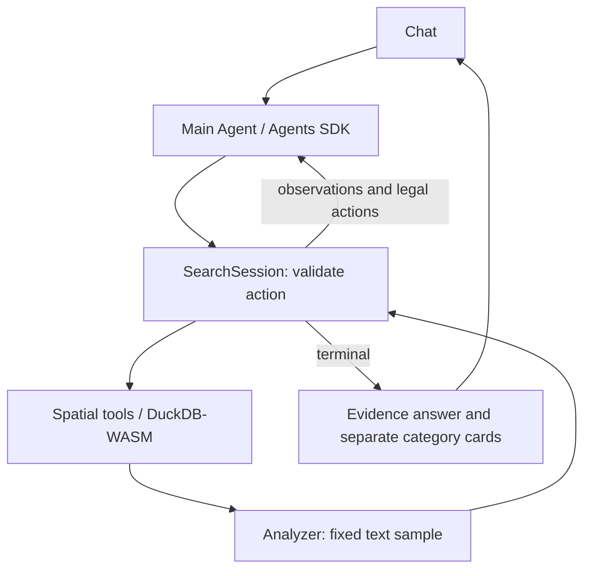

# Atlas Agent architecture

The main Agent chooses a playbook, rectangular rings, refinements and completion requests. SearchSession owns current-turn evidence, transitions, budgets and terminal state. The SDK runs the tool loop. XY is a candidate space; text establishes semantic evidence. No embedding service or vector index is introduced.

See [the versioned search contract](PROJECTION_AGENT_SEARCH.md) for schemas, state transitions, termination and evaluation conditions. Old `SearchPolicy` and `ProjectionController` implementations were removed. Tool schemas and instructions derive from `src/agent/searchContract.ts`.

The API returns tool results, validated card selections, a typed search snapshot, separate Agent/Analyzer usage and a scope-keyed ring ledger for the next turn. SQL uses request-local immutable selected IDs; workspace sets can only narrow that scope. Historical navigation is not current-turn evidence. Exact analytics can complete from returned SQL result sets without an Analyzer. The model receives bounded review excerpts and evidence state; pilot traces record state changes.

The legacy Python pilot implements a different runtime and is retained only for historical analysis. Run the TypeScript SDK pilot for the current implementation.
